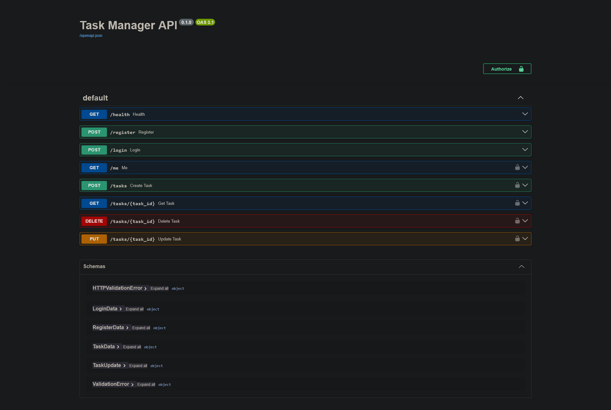

# Task Manager API

A simple REST API for managing personal tasks. Users register and log in, then create, view, update and delete their own tasks. Tasks have a status, a priority and an optional due date, and can be filtered.

## Features

- Register and log in (passwords are stored as bcrypt hashes)
- Token-based authentication (JWT)
- Create, list, view, update and delete tasks
- Each user can only see and change their own tasks
- Filter tasks by status and priority
- Input validation with proper HTTP status codes
- Interactive API documentation (Swagger UI)

## Tech Stack

- **Python 3** with **FastAPI** (web framework)
- **Uvicorn** (server that runs the app)
- **SQLite** (database, using Python's built-in `sqlite3`)
- **bcrypt** (password hashing)
- **PyJWT** (login tokens)
- **python-dotenv** (reads settings from a `.env` file)

## Project Structure

```
task-manager/
├── app/
│   ├── main.py        # routes (register, login, tasks)
│   ├── database.py    # connects to SQLite and creates the tables
│   └── security.py    # password hashing and token helpers
├── .env.example       # template for your own .env file
├── requirements.txt   # list of libraries to install
└── README.md
```

## How to Run

You need Python 3.9 or newer.

```bash
# 1. Clone the project
git clone https://github.com/Vibhu-rs/task-manager-api.git
cd task-manager-api

# 2. Create and activate a virtual environment
python -m venv venv
venv\Scripts\activate          # Windows
# source venv/bin/activate     # Mac / Linux

# 3. Install the libraries
pip install -r requirements.txt

# 4. Create your .env file from the template
copy .env.example .env         # Windows
# cp .env.example .env         # Mac / Linux
# Then open .env and set JWT_SECRET to your own long random text

# 5. Start the server
uvicorn app.main:app --reload
```

The API runs at `http://127.0.0.1:8000`.

## API Documentation

Open **http://127.0.0.1:8000/docs** for interactive Swagger documentation, where you can try every endpoint.

The full API specification is saved in [`docs/openapi.json`](docs/openapi.json). You can import it into Postman (**Import → File**) to get a ready-made collection of every endpoint, or paste it into https://editor.swagger.io to view it without running the server.



To use the task endpoints:
1. Call `POST /register`, then `POST /login`, and copy the `token` from the response.
2. Click **Authorize** at the top of the page and paste the token.
3. The padlock endpoints now work.

**Live demo:** https://task-manager-api-r1nx.onrender.com/docs

> Hosted on a free tier: the first request after inactivity can take ~30 seconds, and data may reset when the service restarts.

### Endpoints

| Method | Endpoint | Login needed | Description |
|--------|----------|--------------|-------------|
| GET | `/health` | No | Check the server is running |
| POST | `/register` | No | Create an account |
| POST | `/login` | No | Log in and get a token |
| GET | `/me` | Yes | Show the logged-in user |
| POST | `/tasks` | Yes | Create a task |
| GET | `/tasks` | Yes | List your tasks (`?status=` and `?priority=` filters) |
| GET | `/tasks/{id}` | Yes | Get one task |
| PUT | `/tasks/{id}` | Yes | Update a task (send only the fields to change) |
| DELETE | `/tasks/{id}` | Yes | Delete a task |

Task fields: `title` (required), `description`, `status` (`todo`, `in_progress` or `done`), `priority` (`low`, `medium` or `high`), `due_date` (like `2026-11-01`).

## How It Works

1. A user registers; the password is hashed with bcrypt and saved.
2. The user logs in and receives a signed token.
3. The user sends the token with each task request.
4. The server reads the token to find out who is calling.
5. Every task query includes `WHERE user_id = ?`, so users only reach their own tasks.

## Security

- No secrets are in the repository. The real `.env` file is listed in `.gitignore`; only `.env.example` with placeholder values is committed.
- Passwords are never stored as plain text.
- SQL queries use `?` placeholders, which prevents SQL injection.

## Possible Improvements

Token expiry, automated tests, pagination, and a PostgreSQL database.